# Guía de usuario: entrenador de forehand en Jetson Nano

## 1. ¿Qué es el entrenador?

El entrenador de forehand es un programa que observa al jugador con una cámara, detecta cada golpe de derecha y, al final de la sesión, le muestra qué hizo bien y qué debe corregir. Funciona en una NVIDIA Jetson Nano y no necesita internet ni sensores en el cuerpo.

Durante la sesión el programa revisa tres aspectos de la técnica en el instante del impacto:

- **Codo:** que el brazo no esté ni muy cerrado ni completamente recto.
- **Muñeca:** que no quede caída por debajo del codo.
- **Rodillas:** que estén flexionadas y estables durante el golpe.

Los valores que usa el programa (ángulo interno, 180° = articulación recta) son:

| Aspecto | Zona ideal | Se marca como error |
| :-- | :-- | :-- |
| Codo (hombro‑codo‑muñeca) | 100° a 135° | Menos de 90° o más de 150° |
| Caída de la muñeca respecto al codo | Hasta 30 % del largo del brazo superior | Más de 70 % |
| Rodilla del lado que golpea | 135° a 165° | Menos de 120° o más de 170° |
| Movimiento de la rodilla durante el golpe | Hasta 35° | Más de 35° genera un aviso |

Estos valores están en la clase `Reglas` de `Forehand_trainer_jetson_trt.py` y se pueden ajustar con los datos del archivo de calibración (sección 8).

Al terminar, el resumen muestra tarjetas con la foto real del golpe, la postura corregida dibujada en verde y un consejo en lenguaje sencillo.

<p align="center">
  <br>
  <em>Figura 1. Vista general del sistema</em>
</p>

## 2. Antes de empezar

Para usar el entrenador se necesita el siguiente equipo:

| Elemento | Para qué sirve |
| :-- | :-- |
| NVIDIA Jetson Nano | Ejecuta el programa y el modelo de detección de postura |
| Cámara USB en trípode | Filma al jugador durante la sesión |
| Pantalla | Muestra la imagen en vivo, los avisos y el resumen |
| Teclado | Maneja el programa; los gestos de la mano solo reemplazan las teclas para iniciar y terminar la sesión |
| Mesa, raqueta y pelotas | Para practicar el golpe |

### Montaje

1. Coloque la cámara a 2–3 m del jugador, en diagonal por detrás de él y del lado del brazo que golpea (a su derecha si es diestro, a su izquierda si es zurdo), de forma que vea **el cuerpo completo del jugador, de la cabeza a los pies**, y el brazo con el que golpea.
2. Fije la cámara en el trípode y manténgala **siempre en la misma posición**. Si se mueve entre sesiones, los ángulos medidos dejan de ser comparables.
3. Ilumine bien la zona de juego. El jugador debe usar camiseta de manga corta y pantaloneta de un color que contraste con el fondo, para que el programa distinga brazos y piernas.
4. Encienda la Jetson Nano y active el modo de máximo rendimiento:
   ```bash
   sudo nvpmodel -m 0 && sudo jetson_clocks
   ```
5. Desde la carpeta del programa, inícielo:
   ```bash
   python3 Forehand_trainer_jetson_trt.py
   ```
6. Espere a que aparezca la pantalla de inicio. La primera ejecución puede tardar varios minutos mientras el programa genera el motor TensorRT del modelo; las siguientes lo reutilizan y arrancan más rápido.

<p align="center">
  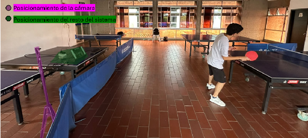<br>
  <em>Figura 2. Ubicación de la cámara</em>
</p>

## 3. Dos formas de usar el sistema

Hay dos modos de uso. El programa funciona igual en ambos; solo cambia quién lo maneja.

### Opción A: con supervisión

Una persona (entrenador o compañero) se queda junto a la Jetson Nano y la pantalla. Observa el programa en tiempo real, maneja los controles y corrige al jugador durante la sesión.

- **Conviene cuando:** el jugador está aprendiendo, o se quiere aprovechar la corrección inmediata de un entrenador.
- **El jugador solo golpea;** el supervisor maneja el programa y corrige su postura.

<p align="center">
  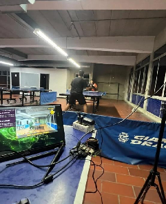<br>
  <em>Figura 3. Disposición con supervisión</em>
</p>

### Opción B: operación autónoma

La pantalla y el teclado se ubican cerca del jugador para que él mismo maneje el sistema. Inicia la sesión con el gesto de la mano libre o con ENTER, observa la pantalla mientras entrena y al final consulta el resumen con las tarjetas de retroalimentación.

- **Conviene cuando:** el jugador entrena solo y quiere revisar su técnica sin depender de otra persona.
- **Recomendación:** ubique la pantalla donde se vea sin salir de la posición de juego y el teclado al alcance, pero fuera de la zona de golpeo.

<p align="center">
  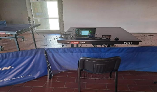<br>
  <em>Figura 4. Disposición autónoma</em>
</p>

## 4. Con quién practicar: compañero o robot de pelotas

El jugador tiene dos opciones para recibir las pelotas. En ambas el programa analiza solo al jugador que está frente a la cámara.

| | Con un compañero | Con un robot de pelotas |
| :-- | :-- | :-- |
| Cómo funciona | El compañero lanza las pelotas desde el otro lado de la mesa | El robot lanza las pelotas de forma continua |
| Ventaja | No requiere equipo adicional | Lanzamientos constantes y repetibles |
| Requisito clave | El compañero debe tener el balde de pelotas | Ajustar el robot para que lance hacia el lado del brazo de golpe |

### Qué golpes detecta el programa

El programa **solo reconoce el golpe de derecha básico (drive)** y solo cuando el movimiento es completo. **No detecta** cortes, topspin, reveses ni servicios. Si el jugador realiza uno de esos golpes, el programa puede ignorarlo o evaluarlo de forma incorrecta.

### Si practica con un compañero

El compañero debe tener **el balde de pelotas a su lado** y ser quien ponga la pelota en juego. Así el jugador que está frente a la cámara no tiene que sacar ni recoger pelotas, y se evita que el programa capture como golpe el movimiento de un servicio o de agacharse a recoger una bola.

<p align="center">
  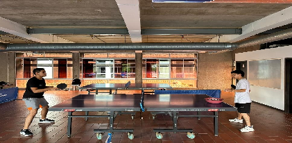<br>
  <em>Figura 5. Práctica con compañero</em>
</p>

## 5. Controles

El programa se maneja de dos formas: con **gestos de la mano libre** (sin tocar el teclado) o con **teclas**.

### Gesto de la mano libre

La mano libre es la que **no** sostiene la raqueta. Para usar el gesto, levántela por encima de la cabeza y manténgala ahí hasta que se complete el anillo de progreso en pantalla. Después de cada gesto, baje la mano antes de hacer otro.

| Gesto | Tiempo | Qué hace | Dónde funciona |
| :-- | :-- | :-- | :-- |
| Mano libre sobre la cabeza | Aprox. 1 s | Empezar una sesión | Pantalla de inicio y resumen |
| Mano libre sobre la cabeza (con el brazo de golpe quieto) | Aprox. 1,5 s | Terminar la sesión | Durante la sesión |

<p align="center">
  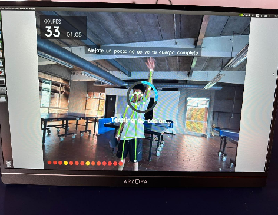<br>
  <em>Figura 6. Gesto de la mano libre</em>
</p>

### Teclas

| Tecla | Qué hace | Dónde funciona |
| :-- | :-- | :-- |
| `ENTER` | Empezar una sesión | Pantalla de inicio y resumen |
| `F` | Terminar la sesión y ver el resumen | Durante la sesión |
| `ESPACIO` | Pausar la imagen y guardar una muestra manual | Durante la sesión |
| `C` | Deshacer el último golpe o muestra guardada | En cualquier momento |
| `D` | Configurar jugador diestro | Fuera de la sesión |
| `Z` | Configurar jugador zurdo | Fuera de la sesión |
| `N` o flecha derecha | Siguiente tarjeta | Resumen |
| `B` o flecha izquierda | Tarjeta anterior | Resumen |
| `P` | Pantalla completa | En cualquier momento |
| `S` | Guardar una captura de pantalla | En cualquier momento |
| `Q` | Salir del programa | En cualquier momento |

> **Importante:** antes de empezar, verifique la mano del jugador. Si es zurdo, presione **Z**; si es diestro, presione **D**. El programa analiza el brazo según esta elección.

<p align="center">
  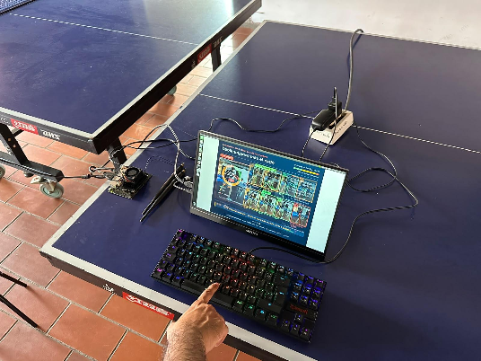<br>
  <em>Figura 7. Uso de los controles</em>
</p>

## 6. Paso a paso de una sesión

Una sesión pasa siempre por cuatro pantallas en este orden: **Inicio → Cuenta regresiva → Sesión → Resumen**.

1. **Pantalla de inicio.** El programa muestra el esqueleto del jugador y una lista de verificación. Antes de empezar deben cumplirse estos cuatro puntos:
   - Jugador dentro del cuadro.
   - Cuerpo completo visible.
   - Brazo de golpe visible.
   - Ninguna otra persona superpuesta al jugador.
2. **Empezar.** Levante la mano libre sobre la cabeza (aprox. 1 s) o presione **ENTER**.
3. **Cuenta regresiva.** Aparece una cuenta de 3 segundos. Úselos para tomar posición de juego.
4. **Sesión.** Golpee con normalidad. El programa detecta cada golpe de derecha y muestra el resultado en pantalla. Para congelar la imagen y guardar una muestra manual, presione **ESPACIO**.
5. **Terminar.** Con el brazo de golpe quieto, levante la mano libre sobre la cabeza (aprox. 1,5 s) o presione **F**.
6. **Resumen.** Revise las tarjetas de retroalimentación (sección 8).
7. **Otra sesión o salir.** Desde el resumen, levante la mano libre o presione **ENTER** para una nueva sesión. Para cerrar el programa, presione **Q**.

<p align="center">
  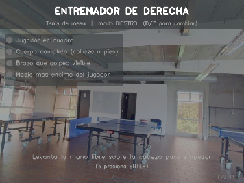
  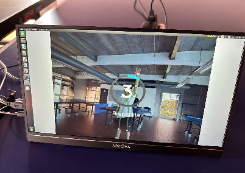<br>
  <em>Figura 8. Pantalla de inicio (izquierda) y cuenta regresiva (derecha)</em>
</p>

## 7. Qué se ve en pantalla durante la sesión

La pantalla muestra el video en vivo con el esqueleto del jugador dibujado encima y algunos indicadores mínimos para no distraer.

| Elemento | Qué significa |
| :-- | :-- |
| Contador de golpes y tiempo | Cuántos golpes se han detectado y cuánto dura la sesión |
| Estado | GOLPEANDO cuando el sistema analiza, o PAUSA si está detenido |
| Círculo en la muñeca | El programa está registrando un golpe en ese momento |
| Pose congelada del impacto | Durante 1,5 s se muestra la postura del último golpe, con el brazo y la pierna en color según la evaluación |
| Insignia del resultado | Aparece unos 3 s: **OK** (golpe correcto), **CASI** (pequeño detalle por mejorar) o **!** (hay que corregir) |
| Barra de consejo | Durante 5 s muestra la corrección más importante del último golpe |
| Puntos de colores | Los últimos 14 golpes, cada uno con el color de su resultado |
| Avisos en gris | «Brazo oculto» o «cuerpo incompleto» cuando la cámara no ve bien al jugador |
| Esqueleto en gris | Otra persona se cruzó con el jugador; el análisis se pausa hasta que se aparte |

<p align="center">
  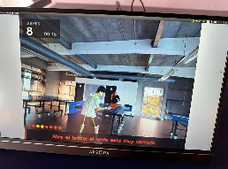
  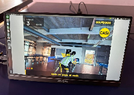<br>
  <em>Figura 9. Pantalla durante la sesión</em>
</p>

## 8. El resumen de la sesión

Al terminar, el programa muestra tarjetas que pasan solas cada 9 segundos. Para avanzar o retroceder antes, use **N / flecha derecha** y **B / flecha izquierda**. Cada tarjeta se guarda automáticamente como imagen PNG.

Hay tres tipos de tarjeta:

### Tarjeta de corrección (máximo 3)

Se genera una por cada parte del cuerpo con errores (codo, muñeca o rodillas) y muestra el error más importante de esa parte:

- **Izquierda:** la foto real del golpe con la parte mal ejecutada resaltada en rojo.
- **Derecha:** la misma foto con la postura corregida en verde y una flecha que indica el movimiento a hacer.
- **Textos:** «Qué pasó», «Cómo corregirlo» y «Por qué importa».
- **Abajo:** en qué golpes ocurrió el error y un medidor con la zona ideal.

<p align="center">
  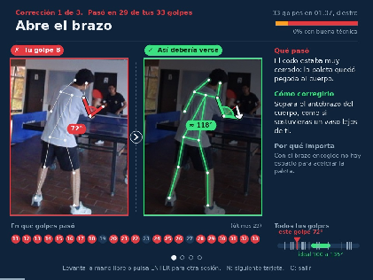
  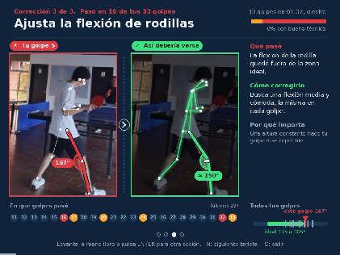<br>
  <em>Figura 10. Tarjetas de corrección</em>
</p>

### Tarjeta del mejor golpe

Muestra el golpe más cercano a la técnica ideal, para que el jugador sepa qué debe repetir.

<p align="center">
  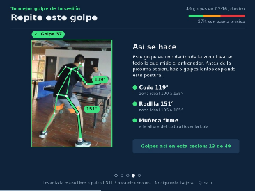<br>
  <em>Figura 11. Tarjeta del mejor golpe</em>
</p>

### Tarjeta de galería

Resume toda la sesión: un gráfico circular con el porcentaje de golpes con buena técnica, miniaturas de los últimos 8 golpes y lo primero que se debe trabajar.

<p align="center">
  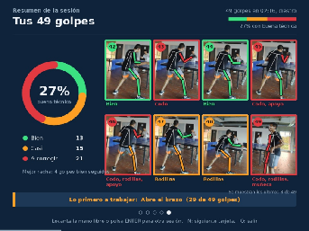<br>
  <em>Figura 12. Tarjeta de galería</em>
</p>

### Archivos que guarda el programa

Los archivos se guardan en la carpeta desde la que se ejecuta el programa.

| Archivo | Contenido |
| :-- | :-- |
| `resumen_sesion_AAAAMMDD_HHMMSS_N.png` | Cada tarjeta del resumen |
| `calibracion_forehand_jetson_v3.csv` | Una fila con las medidas de cada golpe; se acumula entre sesiones |
| `forehand_jetson_<tiempo>.jpg` | Capturas de pantalla tomadas con la tecla S |

## 9. Problemas frecuentes y recomendaciones

| Problema | Causa probable | Solución |
| :-- | :-- | :-- |
| No se detectan los golpes | El golpe no es un drive básico completo, o el brazo no se ve | Haga el golpe de derecha completo y verifique que la cámara vea el brazo |
| Aparece «cuerpo incompleto» | La cámara no ve la cabeza o los pies | Aléjese o reubique la cámara hasta ver el cuerpo completo |
| Aparece «brazo oculto» | El cuerpo tapa el brazo de golpe | Gire un poco la cámara o la posición del jugador |
| El esqueleto se pone gris | Otra persona se cruza frente al jugador | Pida que se aparte; el análisis sigue solo |
| Se registra un golpe que no hubo | Un servicio o recoger pelotas se tomó como golpe | Borre el golpe con la tecla **C** |
| Analiza el brazo equivocado | Mano del jugador mal configurada | Fuera de la sesión, presione **D** (diestro) o **Z** (zurdo) |
| La imagen va lenta | La Jetson no está en máximo rendimiento o la fuente no entrega suficiente corriente | Ejecute `sudo nvpmodel -m 0 && sudo jetson_clocks` antes de iniciar y alimente la Jetson con una fuente de 5 V / 4 A por el conector barrel jack |
| La cámara da imagen negra | Formato de video no compatible | Cambie `CAMARA_MJPG = True` a `False` en el bloque «RUTAS Y CAMARA» al inicio del programa |

### Recomendaciones generales

- Mantenga despejada la zona de juego y el campo de visión de la cámara.
- Antes de entrenar, haga una sesión de prueba corta para verificar la posición de la cámara.
- Haga sesiones cortas y revise el resumen antes de la siguiente, para trabajar una corrección a la vez.
