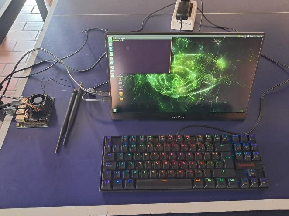

# Trainer-tennis-mesa

Sistema de corrección de técnica para el golpe de derecha (forehand / drive) en tenis de mesa. Una cámara USB filma al jugador, una NVIDIA Jetson Nano estima su postura en tiempo real y, al final de cada sesión, el programa muestra tarjetas con la foto de los golpes, la postura corregida y un consejo para mejorar.

<p align="center">
  
</p>

## Qué hace

- Detecta automáticamente cada golpe de derecha a partir de la velocidad de la muñeca.
- Evalúa en el instante del impacto el ángulo del codo, la caída de la muñeca y la flexión y estabilidad de la rodilla.
- Clasifica cada golpe como **OK**, **CASI** o **!** (hay que corregir) y muestra la corrección principal en pantalla.
- Genera un resumen por sesión con tarjetas de corrección, el mejor golpe y una galería de la sesión.
- Funciona sin internet y sin sensores en el cuerpo. Se maneja con teclado o con un gesto de la mano libre.
- Registra las medidas de cada golpe en un CSV para ajustar los umbrales a cada jugador.

Solo analiza el drive básico; no detecta cortes, topspin, reveses ni servicios.

## Hardware

| Elemento | Detalle |
| :-- | :-- |
| NVIDIA Jetson Nano Developer Kit 4 GB | Fuente de 5 V / 4 A por conector barrel jack |
| Cámara USB | En trípode, a 2–3 m del jugador |
| Pantalla y teclado | Para ver la sesión y manejar el programa |

## Software

| Componente | Versión probada |
| :-- | :-- |
| JetPack / L4T | 4.6.6 / R32.7.6 |
| Python | 3.6.9 |
| PyTorch | 1.10.0 |
| torchvision | 0.11.1 |
| torch2trt | 0.5.0 |
| trt_pose | Modelo `resnet18_baseline_att_224x224_A` (18 puntos COCO) |
| OpenCV, NumPy | Incluidos en JetPack |
| Pillow (opcional) | Texto del resumen |

## Puesta en marcha

1. Instale PyTorch, torchvision, torch2trt y [trt_pose](https://github.com/NVIDIA-AI-IOT/trt_pose) en la Jetson Nano.
2. Copie en la carpeta del programa los pesos preentrenados de trt_pose: `resnet18_baseline_att_224x224_A_epoch_249.pth`.
3. Active el modo de máximo rendimiento y ejecute el programa:
   ```bash
   sudo nvpmodel -m 0 && sudo jetson_clocks
   python3 Forehand_trainer_jetson_trt.py
   ```

En la primera ejecución el programa convierte el modelo a TensorRT y guarda el resultado como `resnet18_baseline_att_224x224_A_epoch_249_trt.pth`. Este paso puede tardar varios minutos; las ejecuciones siguientes reutilizan ese archivo.

La configuración de cámara y rutas está en el bloque «RUTAS Y CAMARA» al inicio de `Forehand_trainer_jetson_trt.py`.

## Documentación

La instalación de la cámara, los modos de uso, los controles, el paso a paso de una sesión y la solución de problemas están en la **[Guía de usuario](GUIA_USUARIO.md)**.

## Estructura del repositorio

```
Trainer-tennis-mesa/
├── Forehand_trainer_jetson_trt.py   Programa principal
├── GUIA_USUARIO.md                  Guía de usuario
├── README.md
└── imagenes/                        Figuras de la guía
```

## Fundamento de los criterios

Los umbrales de la clase `Reglas` parten de la literatura y se ajustan a cada jugador con el archivo de calibración:

- Bańkosz, Z. y Winiarski, S. (2020). *Journal of Sports Science and Medicine*, 19, 138–148.
- Lyu et al. (2025). *Frontiers in Sports and Active Living*, 7, 1635581.

## Autores

Proyecto desarrollado por **Jorge Cabrera** y **Nicolás Manzano**, estudiantes de la **Universidad de San Buenaventura**.
